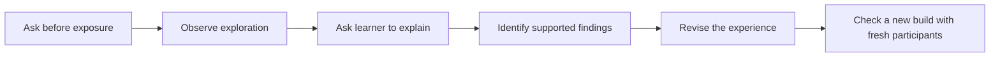

# Proposal: check whether LandShift helps people understand a choice

**Status: Proposed — a study plan, not a completed test or evidence of learning impact.**

Prepared 24 October 2026 against local commit `76ae41e`. This document proposes a small moderated study of the San Francisco Polo Fields demo. It complements the [heat-model proposal](research/heat-reuse-model-proposal.md), and separates the completed heat-data packet from a future UI build.

## Purpose and recommendation

Check whether a young person can explain a land-use consequence, its cause, an alternative's compromise and a useful question before deciding. Use the findings to improve the experience's wording, animation and comparisons.

Recommend a first round with **five participants aged 18–24**, followed by a revised build and a fresh small round if material problems are found. Five is a proposed practical recruitment target, not a statistically representative sample or a promise to discover every issue. Recruit beyond the project team, with varied familiarity with planning and data centres. Beginning with adults covers part of the challenge's 15–24 audience; it leaves suitability for 15–17-year-olds untested.

Use **15–20-minute individual sessions**, a facilitator, a fixed set of prompts and a simple anonymous observation sheet. The first version needs no in-app quiz, account, analytics backend, automatic scoring or persistent chat export. Research participation must not become a progression requirement in the normal experience.



## Current system and missing evidence

| Classification                    | Finding or recommendation                                                                                                                                                                                                                                                                                                        |
| --------------------------------- | -------------------------------------------------------------------------------------------------------------------------------------------------------------------------------------------------------------------------------------------------------------------------------------------------------------------------------- |
| Existing / verified in repository | The [Polo demo](polo-demo.md) provides placement, five-chapter explanations (Today, Foundations, Structure, Ready, Operating), original/proposal switching, heat-recipient and rain experiments, and fictional community conversations.                                                                                          |
| Existing / verified in repository | The current UI presents concept views. A separate [heat-data packet](research/heat-demo-golden-gate-polo/README.md) now supplies checked teaching results for later integration; recycled-water and green-roof results remain unquantified. Source/assumption details and evidence labels are part of the documented experience. |
| Existing / verified in repository | The [challenge brief](challenge-brief.md) asks for accessible learning and an explanation of how understanding, intended behaviour or participation could be assessed. Gameplay activity alone is insufficient evidence.                                                                                                         |
| Not established by this review    | Whether target users understand the causes, transfer the lesson, recognise assumptions or can reason about a proposal. Code checks and authored dialogue do not answer this.                                                                                                                                                     |
| Proposed change                   | Add a repeatable, manually run comprehension study and keep its findings separate from implementation QA, model verification and promotional claims.                                                                                                                                                                             |

The study is about the explanation's usefulness. It must not reward supporting the datacentre, adopting a particular alternative or matching a fictional character's opinion. Supporting, opposing and withholding judgement can all demonstrate sound reasoning.

## What we want to learn

| Objective                               | Evidence we would look for                                    | Example misconception to catch                                                              |
| --------------------------------------- | ------------------------------------------------------------- | ------------------------------------------------------------------------------------------- |
| Connect action to cause and consequence | Explain a change using a causal link                          | “Grading takes another 3.2 ha every time the animation plays.”                              |
| Understand a conditional alternative    | Name a benefit, a requirement and a limitation                | “Reusing heat makes the servers use no electricity.”                                        |
| Separate different land functions       | Distinguish vegetation, public access and original recreation | “A green roof gives the playing field back.”                                                |
| Recognise evidence boundaries           | Identify a fictional/assumed quantity or a missing fact       | “Showing the Lodge and Senior Center on the map means their heat connections are approved.” |
| Apply reasoning to participation        | State a position, reason and decision-relevant question       | “I support it because the simulation's crowd is happier.”                                   |

Do not require memorised PUE, exact litres or technical vocabulary. Plain-language reasoning is sufficient. Evidence boundaries include the fact that the footprint can move without a new GIS impact calculation.

## Proposed session protocol

### Preparation

Record the commit/build, browser/device, interface language, live-AI or authored-offline mode, and whether heat numbers are absent or validated and present. Keep the first round in one consistent mode. Prefer the authored/offline mode for repeatability; record any topic that depends on live answers and assess it separately later. Do not assume participants receive identical explanations when live generation is enabled.

Prepare two short parallel transfer prompts and rotate their pre/post order across participants. Use the same language throughout each session. Have a second team member check the script and scoring examples before recruitment. Arrange a working demo before inviting a participant; technical setup must not consume the session.

### Session flow

| Time allowance | Facilitator action                                                                                               | What to record                                                                                    |
| -------------- | ---------------------------------------------------------------------------------------------------------------- | ------------------------------------------------------------------------------------------------- |
| 1–2 min        | Explain that we are testing the experience, that stopping is allowed, and ask brief prior-familiarity questions. | Anonymous ID, age band, language and relevant familiarity.                                        |
| 2–3 min        | Ask the pre-exposure transfer prompt without correcting or teaching.                                             | Participant's explanation and uncertainty in their own words.                                     |
| 7–9 min        | Give the neutral exploration task below. Let them choose details; observe and ask neutral think-aloud prompts.   | Navigation failures, spontaneous explanations, misconceptions, assistance and material consulted. |
| 4–5 min        | Ask the post-exposure teach-back and parallel transfer prompt before providing feedback.                         | Independent reasoning and its evidence; separate unassisted from prompted answers.                |
| 1 min          | Ask what was confusing, then correct misconceptions during debrief.                                              | Suggested improvements; distinguish debrief learning from test evidence.                          |

The time ranges are session planning allowances, not performance requirements. Offer more time or another format when needed, and record deviations.

Neutral exploration task:

> “Explore how this place changes and try one of the suggested ideas. Afterwards, tell me what you would want to understand before deciding whether to support the proposal. You can open details or talk to characters if useful.”

Use “What are you thinking?” or “What do you expect that control to do?” rather than suggesting an answer. If someone is blocked, give the smallest navigation assistance and record it. Explanations supplied by the facilitator are assistance, not independent comprehension.

### Pre/post transfer prompts

Use these as brief fictional situations; neither asserts an actual approved project. Counterbalance A→B and B→A to reduce dependence on one wording. They are locally authored probes, not validated equivalent assessment items.

- **A:** “A public playing area is proposed for a new technical facility. Its roof would be planted, and some waste heat might go to two nearby park buildings. What would you need to understand before deciding whether to support it, and why?”
- **B:** “An open community recreation area is proposed for a computing building. The proposal includes vegetation on the roof and a possible heat connection to two nearby community buildings. What would you need to understand before deciding whether to support it, and why?”

Accept “I don't know.” Do not supply missing mechanisms during either prompt. Similar pre/post ideas and the pretest itself can influence answers; any change is descriptive within this session, not a causal estimate of educational effectiveness.

### Post-exposure teach-back questions

Ask the open questions first. If a participant did not encounter a relevant topic, mark it **Not exposed**, rather than scoring missing exposure as misunderstanding. After the independent portion, an optional guided visit can diagnose whether the problem is discoverability or explanation; keep that evidence separate.

| Question                                                                                                     | Reasoning to listen for                                                                                                                             |
| ------------------------------------------------------------------------------------------------------------ | --------------------------------------------------------------------------------------------------------------------------------------------------- |
| “Describe one thing that changed on the ground and explain why it matters.”                                  | A causal explanation connecting disturbance or permanent occupation with water pathways, soil or original use. No required calculation.             |
| “What does your chosen idea help with, and what does it still require or leave unresolved?”                  | A supported benefit or possible benefit plus a condition/trade-off. A concept cannot be described as a measured saving.                             |
| “Which parts of what you saw were assumptions or illustrations? What would need checking in a real project?” | Distinguish the fictional project and hypothetical route from the two real recipient buildings, teaching assumptions and unverified heating demand. |
| “What is your view, what is your reason, and what would you ask the planner next?”                           | A reasoned position or justified uncertainty and a useful next question. No preference is inherently correct.                                       |

Only after those answers, use relevant diagnostic follow-ups: “What happens if neither building needs heat?”; “Does a planted roof preserve the original recreation?”; or “Does changing the water source remove the cooling water need?” These targeted questions reveal recognition but can cue the concept, so flag them as **prompted** rather than combining them with spontaneous reasoning.

## Observation and interpretation

Use four dimensions rather than one universal learner score:

| Dimension              | 0                                                                        | 1                                                          | 2                                                                                  |
| ---------------------- | ------------------------------------------------------------------------ | ---------------------------------------------------------- | ---------------------------------------------------------------------------------- |
| Causal explanation     | Missing or materially incorrect                                          | Identifies a change but explains its mechanism only partly | Gives a coherent action → mechanism → consequence explanation                      |
| Trade-off reasoning    | Treats the idea as a complete solution or cannot identify an implication | Names a possible benefit or a constraint                   | Connects a supported benefit with a requirement, limitation or remaining impact    |
| Evidence awareness     | Treats illustrations/assumptions as established project facts            | Expresses general uncertainty                              | Identifies a specific assumption or missing fact and why it matters                |
| Informed participation | Gives an unsupported preference or none                                  | Gives a reason or a useful question                        | Connects a position/withheld judgement, reason and decision-relevant next question |

Record **Not exposed** and **Not assessable** separately from zero. Attach a short quote or faithful paraphrase to every judgement, plus `unassisted`, `neutral follow-up`, `targeted prompt` or `facilitator explanation`. A correct answer after teaching is not an unassisted success. Do not score automatic community mood, clicks, dwell time or apparent agreement as comprehension.

Apply the same dimensions to both transfer answers where assessable. Read the participant's reasoning rather than counting keywords. Keep within-person changes descriptive; do not sum the dimensions into a project-approval score or claim validated measurement.

Have two team members independently score at least two sessions, compare disagreements, refine the examples and recheck affected judgements. This is a consistency check, not psychometric validation. If staffing is limited, disclose that one person both moderated and scored.

## Observation sheet and resulting project work

The proposed observation sheet can be a simple local table; choose storage and an owner before collecting data. Suggested columns:

```text
participant_id | age_band | prior_familiarity | build | device_language_mode
task_or_prompt | topic_exposure | observation_or_quote | assistance_level
dimension | judgement | misconception | affected_scene_or_copy
suggested_change | owner | follow_up_build_and_result
```

Use this outcome format after a round:

1. State who participated, which build/mode they used and what they actually encountered.
2. Report counts with denominators, such as “3 of 4 exposed participants independently distinguished heat delivery from IT electricity.” This is an example reporting format, not a result.
3. List recurring misconceptions and the scene or wording that appeared to contribute; distinguish observation from a proposed explanation.
4. Prioritise concrete revisions and recheck them with fresh participants. Label any returning participant's exposure separately.
5. Preserve unresolved questions and limitations. Do not convert a small convenience sample into population percentages or proof of behaviour change.

Proposed iteration triggers are qualitative product decisions: address any observed false belief that the scenario is a real approved development; investigate the same material misconception occurring independently in two or more exposed sessions; fix a navigation block that prevents the core comparison. These are practical triage rules, not validated pass/fail thresholds. One isolated serious issue can still justify a change.

## Participation and data handling

Keep participation voluntary and explain the activity in plain language. Start with 18–24-year-olds; testing the remaining 15–17 audience requires a separately prepared appropriate consent/safeguarding process before recruitment. This document does not specify jurisdictional legal requirements.

Use anonymous session IDs and minimal notes. Keep contact details separately if recruitment needs them. Do not record audio/video or collect transcripts by default; agree recording separately if it is genuinely needed. Select a responsible owner and deletion date before collection. Ask participants not to enter personal information into the game; live chat sends text to an external provider, as documented in the project. No participant data should be committed to Git by default.

These are lightweight study-operating choices. They do not require a new product consent screen or a monitoring platform.

## How this connects to heat modelling and the demo

**Recipient direction:** the revised heat proposal concerns exactly **Anglers Lodge and Golden Gate Park Senior Center together**. There is no recipient selection task. Assess whether the learner understands one shared source serving two buildings and distinguishes combined demand coverage from two percentages added together. Ask whether the learner distinguishes a real building from an assumed heating need and hypothetical connection. If the tested build still shows the legacy fictional pool, record that mismatch and assess only what was actually shown; it is not a test of the new park-building explanation.

**Before heat data are integrated into the tested UI:** test whether the visual mechanism, recipient-unavailable experiment, green-roof limitation and concept labels are understood. Do not ask participants to compare nonexistent heat quantities.

**After heat data are integrated into the tested UI:** add a separate check of the three primary figures and their boundaries. Ask participants to explain useful heat, recipient coverage and extra electricity without converting thermal MWh into electrical savings. Record which version was tested; a favourable result on the earlier concept does not verify comprehension of the numerical card.

Learning validation does not replace the [transition acceptance tables](research/transitions-demo-golden-gate-polo/transition-checklist.en.md). An animation can meet its technical contract yet convey a mistaken message. A participant can also misunderstand because they never found the relevant explanation. Record and address these as different causes.

The proposed local data work is the session script, scoring examples, observation template and a synthesis of actual findings after sessions. No app code change is required to start. The team still needs to select the facilitator, recruit participants and name the tested build and study-data owner. Finland can be a later transfer exercise only when a usable experience and comparable task are prepared; its existing data packet alone is not a tested Finnish interface.

## Why add this

The project aims to make land-use choices understandable and support participation. This study supplies an inexpensive way to discover whether the experience achieves those immediate learning goals and what to improve. It also supports an honest demo explanation: what was tested, what participants could explain and what remains unknown.

The strongest permissible first claim is a documented observation from a named build and sample. Demonstrating lasting knowledge, changed behaviour or actual influence on local planning would require additional work beyond this formative study.

## Source basis

- [Project challenge brief](challenge-brief.md), sections 3 and 4: owns the audience, learning/participation goals and assessment requirement.
- [Polo demo implementation record](polo-demo.md): owns the current flow, concept-only status and chat/data boundaries. This proposal did not run a new browser audit or participant session.
- [GOV.UK Service Manual: Using moderated usability testing](https://www.gov.uk/service-manual/user-research/using-moderated-usability-testing), checked 24 October 2026: provides a practical basis for observing task completion, using a discussion guide and neutral tasks, and asking participants to think aloud. The prompts, dimensions, recruitment target and iteration rules here are LandShift proposals, not a validated educational test supplied by that source.
