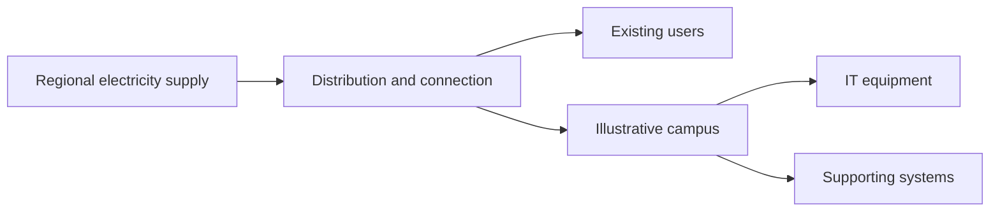

# Golden Gate Park Polo Fields energy demo

English data and 3D handoff for the same **fictional 4 ha / 10 MW average IT** campus as the SF water scenario. Follow [the seven original calculation cards](walkthrough.en.md), [the wider electricity story](wider-energy-story.md) and [generated results](results.md). The real place and public technical references support an authored educational case, not an announced park development or an electrical-service design. Evidence checked 24 October 2026.

## Current demo and calculation stages

Use exactly **Today → Foundations → Structure → Ready → Operating** in the demo. The earlier seven-stop presentation is superseded. Seven analytical stages remain in the data and generated reports; they preserve the original work inventories rather than define seven selectable screens. The [runtime contract](../../polo-demo.md#five-chapter-contract-and-retained-use-cases) owns current controls and animation timing.

| Visible chapter          | Energy interpretation and original calculation stages                                                                                                                                                          |
| ------------------------ | -------------------------------------------------------------------------------------------------------------------------------------------------------------------------------------------------------------- |
| Today (runtime M0)       | Campus inactive. Existing park electricity/fuel remain unknown, not zero.                                                                                                                                      |
| Foundations (runtime M1) | Brief original M1–M3 preparation, then slabs. Preparation fuel remains in optional research details; no foundation-only electricity, fuel or work duration is estimated.                                       |
| Structure (runtime M4)   | Raise frame and roof from completed foundations. Original construction inventory is 38.4 MWh temporary electricity and 6,400 L diesel over 160 selected workdays, covering foundations and structure together. |
| Ready (runtime M5)       | Walls, equipment and grounds finish; original commissioning uses 20 MWh across 10 selected workdays. Generator-test fuel remains unknown. Recurring computing has not started.                                 |
| Operating (runtime M6)   | Original 12 MW average facility demand and 105.12 GWh/year facility electricity, including 17.52 GWh/year supporting systems. IT alone is 87.6 GWh/year.                                                       |

Runtime M1 now means Foundations, while original research M1 still means turf stripping. Do not attach its 300 L tractor allowance to the complete Foundations checkpoint. Original preparation budgets remain 300 / 4,320 / 900 L for stripping / grading / compaction, with their respective workday bases. The full original M4 budget must not be duplicated or split arbitrarily across Foundations and Structure.

Preparation is about 3 screen seconds within Foundations, followed by 5 seconds for slabs. Each later chapter has its own visual endpoint. Screen time never scales the numerical inventory. Continue, Back, direct selection, replay/skip and reset replace complete states without accumulating fuel or electricity. Rain remains independent of annual electricity; operating demand starts only at Operating.

The [original seven research cards](walkthrough.en.md) and [wider electricity story](wider-energy-story.md) are supporting evidence/content references. The default display uses at most three figures and preserves units, time bases and uncertainty. Supporting systems include cooling, electrical losses and other loads; their combined budget is not cooling alone. The 12 MW is an annual average, not a peak connection rating. No numerical alternative cooling design or heatwave forecast is supplied.

## The wider electricity story

Use one small schematic strip rather than a network simulator:



The branches explain that new demand must be considered alongside other users. They do not establish that the campus and particular homes share a feeder. Keep **Actual connection and spare capacity not assessed** visible. Nearby-home lights stay steady; do not show depleted reserves, blackouts or a real street being excavated.

The local context has a useful distinction: SFPUC requires development on City-owned property to apply for Hetch Hetchy Power and describes service arrangements involving PG&E distribution. CleanPowerSF provides another city example of energy procurement using PG&E delivery. These relationships do not select the campus contract, route or available capacity. [SFPUC developers](https://www.sfpuc.gov/hetch-hetchy-power), [CleanPowerSF FAQ](https://cleanpowersf.org/faq)

A service assessment could identify connection works or reinforcement beyond the site. Their location, scale and necessity remain unknown. Utility-governed load interconnection and CAISO's broader planning are different roles. [CAISO large loads](https://www.caiso.com/generation-transmission/load/large-loads)

Hot weather can increase regional air-conditioning demand. The optional question explains concurrent needs without producing an unsupported Polo heatwave forecast or predicting a shortage. [CEC summer reliability](https://www.energy.ca.gov/data-reports/california-energy-planning-library/reliability/summer-reliability)

## What the operating numbers mean

The inherited **10 MW is already average IT electrical demand**. Multiply it by 8,760 hours once. The selected annual electrical PUE of **1.20** gives:

| Quantity                              | Calculation                    |           Result |
| ------------------------------------- | ------------------------------ | ---------------: |
| IT electricity                        | 10 MW × 8,760 h                |  87,600 MWh/year |
| Facility electricity                  | IT electricity × 1.20          | 105,120 MWh/year |
| Supporting systems                    | Facility − IT                  |  17,520 MWh/year |
| Average facility demand               | Facility electricity / 8,760 h |            12 MW |
| Support share of facility electricity | 17,520 / 105,120               |           16.67% |

PUE 1.20 comes from the July 2025 SJ04 developer design reference, which also underlies the existing cooling-water assumption. Its original design load, weather and service differ from this campus. We deliberately treat its average as a transferred annual site-electricity assumption; no coastal-climate efficiency improvement, server fit or measured Polo performance is inferred. The source's peak PUE **1.27** is not applied to our average 10 MW to invent a peak load. [SJ04, printed pp.7–9 / PDF pp.8–10](https://efiling.energy.ca.gov/GetDocument.aspx?DocumentContentId=101543&tn=264764)

The existing **1.25 L/kWh IT** is a cooling make-up supply factor, not PUE or evaporative consumption. The packet reproduces **109,500 m³/year make-up**, **82,125 m³/year evaporation** and **27,375 m³/year blowdown**. Cooling water is tied to IT energy, not multiplied by total facility energy. Domestic supply and irrigation stay in the water packet; they are not added to this cooling comparison.

Normal-operation electricity is assumed supplied from the grid, without on-site generation or storage credits. This is a demand budget; standby-test/outage fuel is unknown and no full lifecycle energy total is claimed. Net electricity change against the existing park is also unknown because its current energy inventory is unavailable.

## Construction and comparison limits

The stage quantities come from explicit machine counts, average rates and engine-on or electrical hours in [scenario.json](scenario.json). The **12 L/hour grading rate** uses the midpoint of a manufacturer earthmoving example. That brochure describes a noncertified-emission engine, so it provides only a consumption anchor, not a proposed California fleet. Other fuel rates, all hours and equipment counts, temporary power and commissioning loads are authored teaching assumptions. Idle time is included within the selected engine-on hours. [Caterpillar brochure, PDF pp.1 and 4](https://s7d2.scene7.com/is/content/Caterpillar/CM20231103-119fd-8ac71)

The listed items sum to **11,920 L diesel** and **58,400 kWh grid electricity**, kept separate. They omit unlisted machinery, water trucks, material production, transport, offsite utility works and generator-test fuel. These partial sums cannot establish which lifecycle stage dominates the complete project.

No numerical alternative cooling design is supplied: the sources do not establish a compatible SF technology/weather pair. The cards explain that reducing direct water use can change electrical requirements, while avoiding a universal penalty or invented savings. The existing prototype's unrelated coefficients are not used. See [methodology.md](methodology.md) for the parameter choices and source boundaries.

## Files and reproduction

| File                                      | Purpose                                                                                                           |
| ----------------------------------------- | ----------------------------------------------------------------------------------------------------------------- |
| `scenario.json`                           | Shared inherited inputs, PUE assumption, equipment inventories and explicit unknowns.                             |
| `sources.json`, `raw/`                    | Source registry with locators and SHA-256 hashes; original public evidence and frozen inherited scenario/results. |
| `compute.py`                              | Offline generator, accounting validation and negative-input checks; Python 3.9+ standard library.                 |
| `results.json`, `results.md`              | Derived energy budget and selected stage inventories.                                                             |
| `milestone-copy.en.json`                  | Authored English scene guidance, visible assumptions, wider-context beats and optional questions.                 |
| `milestones.en.json`, `walkthrough.en.md` | Generated machine handoff and readable seven-card preview.                                                        |
| `wider-energy-story.md`                   | Generated regional narrative and scene instructions.                                                              |
| `preservation-sha256.json`                | Pre-task hashes for 43 existing SJ, SF and Muhos water files.                                                     |
| `review.md`                               | Verification scope, checks and independent review result.                                                         |

```sh
python3 docs/research/energy-demo-golden-gate-polo/compute.py
python3 docs/research/energy-demo-golden-gate-polo/compute.py --check --self-test
```

Generation needs no network or sibling packet: inherited scenario/results are bundled. When repository siblings exist, their hashes are compared with the preservation manifest. Source PDFs/HTML are frozen evidence, not executable content or product assets. Hashes pin the downloaded bytes, not an official document signature.

The handoff follows the water card pattern: `primary_metrics` and `detail_metrics` are paths into a card's `data`; root `metric_definitions` specifies units, display conversion, time basis and evidence labels. `operation` is null before M6. `wider_context` has its default sentence, animation instructions and status. Unknown values display **Not established**, never zero. This data packet supplies no application implementation or service approval.
